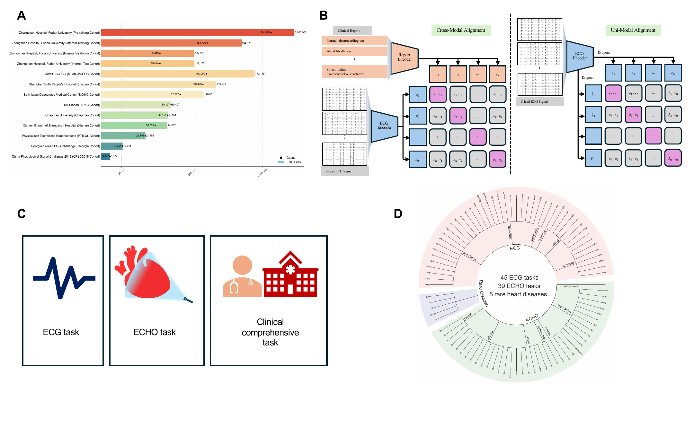

<div align="center">


[](https://arxiv.org/abs/2605.25446)
[](https://www.python.org/)
[](https://pytorch.org/)
[](LICENSE)


Official implementation of  
**A Signal-Language Foundation Model for Broad-Spectrum Cardiovascular Assessment from Routine Electrocardiography**

</div>

---

## 📢 News

- **May 2026** — The ECGCLIP paper is available on [arXiv](https://arxiv.org/abs/2605.25446).
- **Code release** — Contrastive pretraining, ECGCLIP-R34 fine-tuning, and rare-disease SVM evaluation are available in this repository.
- **Planned** — Author-pretrained **ECGCLIP-R18**, **ECGCLIP-R34**, and **ECGCLIP-R50** checkpoints will be released after paper acceptance.

## 🔍 Overview

ECGCLIP aligns routine ECG waveforms with expert diagnostic reports through
signal-language contrastive learning. The model was pretrained on 2,837,962 ECG
studies from 1,324,856 patients and evaluated across 89 downstream tasks,
including ECG diagnoses, echocardiographic targets, and rare cardiovascular
diseases. See the [paper](https://arxiv.org/abs/2605.25446) for the complete
methodology and experimental results.

<p align="center">
  
</p>

<p align="center"><em>Overview of the ECGCLIP cohorts, signal-language learning framework, and downstream evaluation tasks.</em></p>

### ✨ Highlights

- **Large-scale signal-language pretraining** using paired ECGs and clinical reports.
- **Broad-spectrum assessment** across common ECG findings, structural cardiac targets, and rare diseases.
- **Data-efficient transfer** with downstream experiments at 100%, 10%, and 1% training-data fractions.

## 🧠 Model Zoo

The author-trained ECGCLIP weights are intentionally not included in the initial
source-code release.

| Model | ECG encoder | Release status | Checkpoint |
|:--|:--|:--:|:--:|
| ECGCLIP-R18 | ResNet-18 | After acceptance | Coming soon |
| ECGCLIP-R34 | ResNet-34 | After acceptance | Coming soon |
| ECGCLIP-R50 | ResNet-50 | After acceptance | Coming soon |

The language encoder is the public
[`ncbi/MedCPT-Query-Encoder`](https://huggingface.co/ncbi/MedCPT-Query-Encoder);
its files are downloaded from Hugging Face or supplied through a local path.

## 🚀 Getting Started

### 1. Installation

The reference environment uses Python 3.10. Install the PyTorch build matching
your CUDA environment, then install the remaining packages:

```bash
pip install -r requirements.txt
```

### 2. Prepare the data

This repository consumes preprocessed ECG data. Private clinical data,
preprocessing/statistics code, and author split files are not part of this
release.

```text
data/
├── ecg_data_all.h5
├── ecg_labels_all.csv
├── all_information.csv
└── new_split_v2/
    ├── pretrain_train_indices.csv
    ├── pretrain_valid_indices.csv
    ├── downstream_train_indices.csv
    ├── downstream_train_indices_10_percent.csv
    ├── downstream_train_indices_1_percent.csv
    ├── downstream_valid_indices.csv
    └── downstream_test_indices.csv
```

| File | Required content |
|:--|:--|
| `ecg_data_all.h5` | An `ECGs` dataset indexed on the first axis; native input shape is `[N, 8, signal_length]`. |
| `ecg_labels_all.csv` | A `Filename` column whose rows align with the first dimension of `ECGs`. |
| `all_information.csv` | `Filename`, `english_report`, and the downstream target columns used in your experiment. |
| Split CSV files | An integer `index` column referring to the aligned HDF5/CSV rows. |

Use `DATA_ROOT=/your/data/path` when launching a script if the data are stored
elsewhere.

### 3. Run an experiment

Only the three entry points used for the public release are retained:

| Purpose | Entry point | Notes |
|:--|:--|:--|
| Contrastive pretraining | [`scripts/run_clip.sh`](scripts/run_clip.sh) | Supports ResNet-18/34/50 through `ECG_MODEL`. |
| ECGCLIP-R34 fine-tuning | [`scripts/run_downstream_ecg_r34.sh`](scripts/run_downstream_ecg_r34.sh) | Runs the ECG multi-label task at 100%, 10%, and 1% data fractions. |
| Rare-disease SVM | [`scripts/run_downstream_ecg_r34_svm.sh`](scripts/run_downstream_ecg_r34_svm.sh) | Runs the five rare-disease labels using pre-extracted ECGCLIP-R34 features. |

#### ⚡ Contrastive pretraining

```bash
# Defaults to ECGCLIP-R18
bash scripts/run_clip.sh

# Example: pretrain ECGCLIP-R34
ECG_MODEL=resnet34 EXP_NAME=ecg_clip_r34 bash scripts/run_clip.sh
```

Common overrides are `DATA_ROOT`, `OUTPUT_ROOT`, `NPROC_PER_NODE`, `ECG_MODEL`,
`EXP_NAME`, and the text-encoder settings described below.

#### 🎯 ECGCLIP-R34 fine-tuning

Use the released script rather than constructing a separate command:

```bash
PRETRAINED_CHECKPOINT=/path/to/ecgclip-r34.pt \
DATA_ROOT=/path/to/data \
bash scripts/run_downstream_ecg_r34.sh
```

Before the public weights are released, `PRETRAINED_CHECKPOINT` must point to
your own ECGCLIP-R34 pretraining checkpoint. For the repository's legacy output
layout, omit that variable and set `PRETRAIN_OUTPUT_ROOT` and
`PRETRAINED_EXP_NAME` instead.

#### 🩺 Rare-disease SVM evaluation

Rare-disease experiments use SVMs over pre-extracted ECGCLIP-R34 features, as in
the retained script:

```text
data/ecg_features_v3/zs/ecg_clip_r34/
├── train_features.h5
├── valid_features.h5
└── test_features.h5
```

```bash
DATA_ROOT=/path/to/data \
bash scripts/run_downstream_ecg_r34_svm.sh
```

The script trains and evaluates the five rare-disease tasks by default. Set
`TEST_ONLY=True` only when the corresponding saved SVM checkpoints already
exist.

## 🌐 Text Encoder: Online and Offline

With internet access, the default model ID is downloaded and cached
automatically:

```bash
TEXT_MODEL=ncbi/MedCPT-Query-Encoder \
TEXT_MODEL_LOCAL_FILES_ONLY=False \
bash scripts/run_clip.sh
```

For a network-isolated server, first download the complete Hugging Face model
directory on an internet-connected machine:

```bash
python -c "from huggingface_hub import snapshot_download; snapshot_download(repo_id='ncbi/MedCPT-Query-Encoder', local_dir='MedCPT-Query-Encoder')"
```

Transfer the directory to the server and launch with:

```bash
TEXT_MODEL=/path/to/MedCPT-Query-Encoder \
TEXT_MODEL_LOCAL_FILES_ONLY=True \
bash scripts/run_clip.sh
```

See [`pretrained_models/text_encoder/README.md`](pretrained_models/text_encoder/README.md)
for the repository placeholder policy.

## 📦 Release Scope

- Included: model definitions, contrastive pretraining, ECGCLIP-R34 fine-tuning,
  internal-test inference, and rare-disease SVM evaluation.
- Not included: private ECG data, author split files, data construction and
  statistics pipelines, author-trained ECGCLIP checkpoints, or third-party
  model weights.
- Large weights, HDF5 data, serialized models, logs, and generated outputs are
  excluded through `.gitignore`.

## 🙏 Acknowledgements

We thank the authors of
[`cheliu-computation/MERL-ICML2024`](https://github.com/cheliu-computation/MERL-ICML2024)
for making their work publicly available. Their open-source repository provided
a valuable reference for this project and its experimental comparisons.

## 📜 Citation

If you find ECGCLIP useful, please cite:

```bibtex
@article{yu2026ecgclip,
  title   = {A Signal-Language Foundation Model for Broad-Spectrum Cardiovascular Assessment from Routine Electrocardiography},
  author  = {Yu, Ziqing and Tao, Yuhui and Huo, Jiayu and Pan, Lei and Xiao, Zilong and Chen, Juecheng and Li, Xiao and Li, Jianxuan and Zhou, You and Li, Zhixing and Wang, Cong and Zhang, Beijian and Chen, Chen and Lu, Hongyang and Patlatzoglou, Konstantinos and Kramer, Daniel B. and Waks, Jonathan W. and Su, Yangang and Ng, Fu Siong and Wang, Shuo and Liang, Yixiu and Ge, Junbo},
  journal = {arXiv preprint arXiv:2605.25446},
  year    = {2026}
}
```

## 📄 License

This project is released under the [MIT License](LICENSE).
