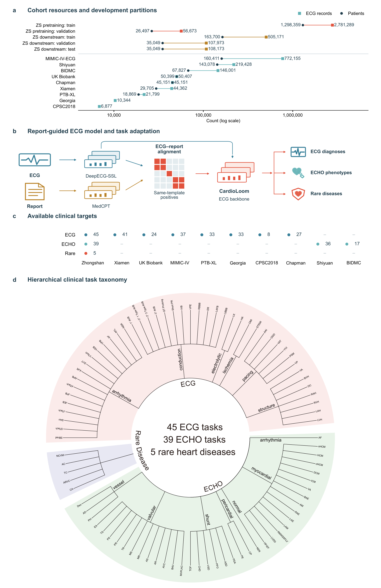

<h1 align="center"></h1>

<p align="center"><strong>A report-guided electrocardiogram foundation model for cross-domain cardiovascular phenotyping</strong></p>

<p align="center">
  <a href="https://arxiv.org/abs/2605.25446"></a>
  <a href="https://arxiv.org/pdf/2605.25446"></a>
  <a href="https://github.com/dt-yuhui/CardioLoom"></a>
  <a href="#quick-start"></a>
</p>

CardioLoom learns from a signal that is already part of routine care: the report written for each ECG. During pretraining, a waveform encoder initialized from [DeepECG-SSL](https://github.com/HeartWise-AI/DeepECG-SSL-finetune) learns alongside a [MedCPT](https://huggingface.co/ncbi/MedCPT-Query-Encoder) report encoder. ECGs with the same normalized report share a positive target. After pretraining, **only the waveform is needed** to score a new ECG.

[](docs/images/study-overview.png)

*Figure 1. CardioLoom was pretrained on 2,781,289 ECG–report pairs from 1,298,359 patients. The study evaluated 45 routine ECG diagnoses, 39 echocardiographic findings and five rare diseases, with external testing in nine cohorts. Click the figure to enlarge it.*

[⚡ Quick start](#quick-start)　·　[🧬 Training](#training)　·　[🫀 Inference](#inference)　·　[📖 Citation](#citation)

## Quick start

**Try the pipeline on a CPU without downloading any ECGs or checkpoints.** From a checkout of this repository, use a Python 3.9 environment with PyTorch 2.3.0, NumPy, pandas, h5py and scikit-learn. For a fresh environment, the following installs just the dependencies for this example:

```bash
git clone https://github.com/dt-yuhui/CardioLoom.git
cd CardioLoom
python -m pip install torch==2.3.0 numpy==1.26.4 pandas==2.3.3 h5py==3.12.1 scikit-learn==1.5.0
bash scripts/quickstart.bash
```

Expected final line:

```text
PASS: synthetic input, lead reconstruction, template sampling, multi-positive loss/backward, validation threshold, paired bootstrap and BH.
```

The example creates eight artificial ECGs and reports in a temporary directory. It checks waveform loading, lead reconstruction and the training loss, then tests threshold selection and statistical evaluation with synthetic scores. A successful run leaves no patient files or model checkpoint.

## Training

The study configuration uses two GPUs for pretraining. For real training, install the [research dependencies](requirements.txt) and prepare the upstream DeepECG-SSL checkpoint, toolkit, MedCPT encoder, ECG files and patient splits as described in [Inputs and setup](docs/reproduction.md). Trained CardioLoom weights and hospital data are not bundled.

**1. Pretrain the encoder.** Point the following variables at your local inputs. Each HDF5 record contains 10 seconds of ECG in mV: eight leads in the order I, II, V1–V6, sampled at 500 Hz.

```bash
export DATA_ROOT=/path/to/prepared-data
export DEEPECG_FAIRSEQ=/path/to/DeepECG-SSL-finetune
export DEEPECG_CHECKPOINT=/path/to/SSL_pretrained.pt
export MEDCPT_DIR=/path/to/MedCPT-Query-Encoder
export CARDIOLOOM_WORK="$PWD/work"
bash scripts/run.bash pretrain
```

Under `work/outputs/pretrain/cardioloom/`, the run writes a training log, a resumable `cardioloom-checkpoint.pth` and validation-selected model files. For downstream training use the file ending in **`_loss.pt`**. Its name includes the epoch and validation loss, so it will depend on your run.

**2. Fit a downstream head.** This example trains a head for heart failure with reduced ejection fraction (HFrEF). Use the same shell and the checkpoint from step 1:

```bash
loss_files=("$CARDIOLOOM_WORK"/outputs/pretrain/cardioloom/*_loss.pt)
export CARDIOLOOM_CHECKPOINT="${loss_files[0]}"
bash scripts/run.bash finetune lvef --dry-run
bash scripts/run.bash finetune lvef
```

The dry run prints input paths, whether files exist, the planned output directory and training parameters. It does not train a model. The second command trains the head and saves **`work/outputs/finetune/cardioloom_lvef/best-checkpoint.pth`**, selected by validation AUPRC. Use that checkpoint in the [inference example](#inference).

| To train on… | Use |
|---|---|
| Routine ECG diagnoses | `bash scripts/run.bash finetune ecg` |
| Echocardiographic findings or valve disease | `bash scripts/run.bash finetune echo` or `bash scripts/run.bash finetune valve` |
| A single AF or HFrEF endpoint | `bash scripts/run.bash finetune af` or `bash scripts/run.bash finetune lvef` |
| A sparse endpoint such as cardiac amyloidosis | [Extract frozen features, then fit an SVM](docs/reproduction.md#sparse-endpoints) |

## Inference

With the trained HFrEF head, score an external HDF5 file containing an `ECGs` array of shape `[N, 8, 5000]`. No reports or labels are needed for this step.

```bash
python -m cardioloom.scripts.predict \
  --input external.h5 \
  --head "$CARDIOLOOM_WORK/outputs/finetune/cardioloom_lvef/best-checkpoint.pth" \
  --output hfref_scores.npz --device cuda
```

Inspect the saved file:

```python
import numpy as np

with np.load("hfref_scores.npz", allow_pickle=False) as result:
    print(result["tasks"].tolist())  # ['lvef_label']
    print(result["scores"].shape)    # (N, 1), one row per input ECG
```

For this head, each score is the model's positive-class softmax output. For multitask heads, look up columns by task ID using the [task dictionary](configs/tasks.csv). Sparse SVM heads return signed decision margins.

**Evaluate a labeled cohort.** For one endpoint, prepare separate validation and test CSVs with columns `label,score`, with labels and scores matched to the same ECGs. Then run:

```bash
python -m cardioloom.scripts.metrics validation.csv test.csv
```

The command prints JSON with `AUPRC`, `AUROC`, the validation-selected `threshold` and the test confusion counts (`tp`, `fp`, `tn`, `fn`). It also reports sensitivity, specificity and positive predictive value at that fixed threshold. For the 99%-specificity screening rule, see [Inference and evaluation](docs/evaluation.md).

## Citation

Yu Z, Tao Y, Huo J, et al. **CardioLoom: A Report-Guided Electrocardiogram Foundation Model for Cross-Domain Cardiovascular Phenotyping.** arXiv (2026). [doi:10.48550/arXiv.2605.25446](https://doi.org/10.48550/arXiv.2605.25446). [Export BibTeX from arXiv](https://arxiv.org/bibtex/2605.25446) or use the [software citation file](CITATION.cff).
